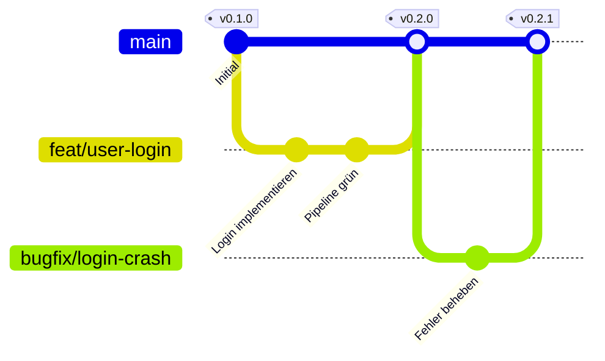

# M324-Gruppe-4
 
## Inhaltsverzeichnis
 
- [Lernjournal](#lernjournal)
- [Zeit logging](#zeit-logging)
- [Entscheidungen](#entscheidungen)
- [Branching-Strategie](#branching-strategie)
  - [Branch-Typen](#branch-typen)
  - [Namenskonventionen](#namenskonventionen)
  - [Erlaubte Merge-Wege](#erlaubte-merge-wege)
  - [Anwendungsbeispiel](#anwendungsbeispiel)
- [Semantic Versioning](#semantic-versioning)
## Lernjournal
 
- Sandro, [Lernjournal Google Docs](https://docs.google.com/document/d/1CIr05FZOiyJgAC_m1EpGrpeQ7XEgO1Q3kbUQgy1xe44/edit?tab=t.0#heading=h.gaj5ai4ayi09)
- Jan, [Lernjournal Google Docs](https://docs.google.com/document/d/1oOOwJ9HIVef2mdvviXlyIAiXMGHFq_CySZcNQuIQxgE/edit?usp=sharing)
- Adam, [Lernjournal Google Docs](https://docs.google.com/document/d/1YMZ6UcXM88czRquw2p_SXW3Ot-o4Y-bcKamcDtIAo3Y/edit?tab=t.0#heading=h.nyaw0211jzfp)
## Zeit logging
 
[Zeit Log Excel](https://tbzedu.sharepoint.com/:x:/r/sites/IT_AP23e_M324-Gruppe4-Projektxy/_layouts/15/Doc.aspx?sourcedoc=%7B03c795c6-5436-419d-9829-98f1d316995e%7D&action=edit&wdexp=TEAMS-TREATMENT&wdenableroaming=1&wdfr=1&wdlcid=en-GB&wdorigin=TEAMS-MAGLEV.teamsSdk_3ed5b337-c2c9-4d5d-b7b4-84ff09a8fc1c_ns.rwc&wdhostclicktime=1794215220597&wdredirectionreason=Force_SingleStepBoot&wdinitialsession=d9b10a9a-3d0a-bfe5-3855-ec370dc7d36f&wdrldsc=2&wdrldc=1&wdrldr=Save%2CContinueInExcel&share=cQrGlccDNlSdQZgpmPHTFpleEgUBDbWtB1ocEBABMtV5piLPEw)
 
## Entscheidungen
 
| Datum      | Entscheidung                                         | Begründung                                                            |
|------------|------------------------------------------------------|-----------------------------------------------------------------------|
| 2026-11-23 | Drei Branch-Typen: `main`, `feat/...`, `bugfix/...`  | Kein `dev` nötig und kein halb kaputter Branch, Tests laufen direkt auf den Arbeitsbranches |
 
## Branching-Strategie
 
Wir verwenden nur drei Branch-Typen. Die Pipeline-Tests laufen direkt auf den `feat/...`- und `bugfix/...`-Branches, deshalb brauchen wir keinen `dev`-Branch.
 

 
### Branch-Typen
 
| Branch       | Verwendungszweck                          | Zustand                                      |
|--------------|-------------------------------------------|----------------------------------------------|
| `main`       | Stabiler Stand mit reviewtem, getestetem Code | ✅ Muss **immer** funktionieren          |
| `feat/...`   | Neue Features schreiben, testen, prüfen   | ⚠️ Darf zwischenzeitlich nicht funktionieren |
| `bugfix/...` | Fehler beheben, die bereits in `main` sind | ⚠️ Darf zwischenzeitlich nicht funktionieren |
 
- Beide Arbeitsbranches werden von `main` aus angelegt und nach dem Merge gelöscht.
- **Voraussetzung für eine MR/PR:** Der Branch ist buildbar und komplett umgesetzt.
- Fehler in einem noch nicht gemergten Feature werden direkt auf dem `feat/...`-Branch behoben.
### Namenskonventionen
 
Format: `feat/<kurzbeschreibung>` oder `bugfix/<kurzbeschreibung>`, in Kleinbuchstaben mit Bindestrichen, optional mit Ticket-Nummer.
 
Beispiele: `feat/user-login`, `feat/12-profil-seite`, `bugfix/login-crash`
 
### Erlaubte Merge-Wege
 
| Von                | Nach               | Erlaubt | Bedingung                                      |
|--------------------|--------------------|---------|------------------------------------------------|
| `feat/…`, `bugfix/…` | `main`           | ✅      | Nur per MR/PR, nach Review und grüner Pipeline |
| `main`             | `feat/…`, `bugfix/…` | ✅    | Um den Branch aktuell zu halten                |
| `feat/…` ↔ `bugfix/…`, `feat/…` ↔ `feat/…` | – | ❌ | Branches bleiben unabhängig          |
| direkt             | `main`             | ❌      | Kein Push auf `main`                           |
 
### Anwendungsbeispiel
 
```bash
# Branch von main anlegen
git checkout main
git pull
git checkout -b feat/user-login
 
# Entwickeln und pushen (Pipeline läuft automatisch)
git add .
git commit -m "Login-Formular implementiert"
git push -u origin feat/user-login
 
# Bei Bedarf main nachziehen
git merge origin/main
 
# Buildbar und komplett? -> MR/PR gegen main, Review, Merge, Branch löschen
```
 
Ein Bugfix läuft gleich ab, nur mit `git checkout -b bugfix/login-crash`.
 
## Semantic Versioning
 
Wir verwenden [Semantic Versioning](https://semver.org/lang/de/) im Format `MAJOR.MINOR.PATCH`. Bis zur ersten stabilen Version beginnen wir mit `0.y.z`.
 
| Teil    | Wird erhöht bei                              | Branch         |
|---------|----------------------------------------------|----------------|
| `MAJOR` | Inkompatiblen Änderungen (Breaking Changes)  | `feat/...`     |
| `MINOR` | Neuer, abwärtskompatibler Funktionalität     | `feat/...`     |
| `PATCH` | Abwärtskompatiblen Fehlerbehebungen          | `bugfix/...`   |
 
**Zusammenhang mit den Branches:** Nur `main` wird versioniert. Nach jedem Merge eines Arbeitsbranches setzen wir auf `main` einen Tag mit Präfix `v`. Der Branch-Typ bestimmt, welcher Teil erhöht wird.
 
| Ereignis                                   | Version                |
|--------------------------------------------|------------------------|
| `feat/user-login` wird gemergt             | `v0.1.0` → `v0.2.0`    |
| `bugfix/login-crash` wird gemergt          | `v0.2.0` → `v0.2.1`    |
 
```bash
git checkout main
git pull
git tag -a v0.2.0 -m "Login-Feature"
git push origin v0.2.0
```
