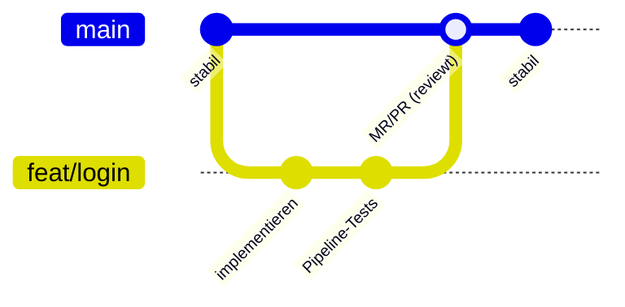

# M324-Gruppe-4

## Inhaltsverzeichnis
 
- [Lernjournal](#lernjournal)
- [Zeit-Logging](#zeit-logging)
- [Entscheidungen](#entscheidungen)
- [Branching-Strategie](#branching-strategie)

## Lernjournal
- Sandro, [Lernjournal Google Docs](https://docs.google.com/document/d/1CIr05FZOiyJgAC_m1EpGrpeQ7XEgO1Q3kbUQgy1xe44/edit?tab=t.0#heading=h.gaj5ai4ayi09)
- Jan, [Lernjournal Google Docs](https://docs.google.com/document/d/1oOOwJ9HIVef2mdvviXlyIAiXMGHFq_CySZcNQuIQxgE/edit?usp=sharing)
- Adam, [Lernjournal Google Docs](https://docs.google.com/document/d/1YMZ6UcXM88czRquw2p_SXW3Ot-o4Y-bcKamcDtIAo3Y/edit?tab=t.0#heading=h.nyaw0211jzfp)

## Zeit logging
[Zeit Log Excel](https://tbzedu.sharepoint.com/:x:/r/sites/IT_AP23e_M324-Gruppe4-Projektxy/_layouts/15/Doc.aspx?sourcedoc=%7B03c795c6-5436-419d-9829-98f1d316995e%7D&action=edit&wdexp=TEAMS-TREATMENT&wdenableroaming=1&wdfr=1&wdlcid=en-GB&wdorigin=TEAMS-MAGLEV.teamsSdk_3ed5b337-c2c9-4d5d-b7b4-84ff09a8fc1c_ns.rwc&wdhostclicktime=1794215220597&wdredirectionreason=Force_SingleStepBoot&wdinitialsession=d9b10a9a-3d0a-bfe5-3855-ec370dc7d36f&wdrldsc=2&wdrldc=1&wdrldr=Save%2CContinueInExcel&share=cQrGlccDNlSdQZgpmPHTFpleEgUBDbWtB1ocEBABMtV5piLPEw)

## Entscheidungen
Wichtige Entscheidungen mit Begründung festhalten.

### Branching-Strategie
Wir verwenden bewusst nur **zwei Branch-Typen**. Die Pipeline-Tests laufen direkt auf den `feat/...`-Branches. Dadurch brauchen wir keinen `dev`-Branch und haben keinen halb kaputten Integrationsbranch.
 

 
| Branch    | Zweck                                | Qualität                                  | Erlaubter Zustand                          |
|-----------|--------------------------------------|-------------------------------------------|--------------------------------------------|
| `main`    | Stabiler, auslieferbarer Stand       | Reviewt, getestet, **immer lauffähig**    | ✅ Funktioniert jederzeit                  |
| `feat/…`  | Entwicklung neuer Features           | Wird laufend getestet und überprüft       | ⚠️ Darf zwischenzeitlich nicht funktionieren |
 
#### `main`
 
- Enthält nur guten, reviewten und getesteten Code.
- Muss immer funktionieren.
#### `feat/...`
 
- Hier wird neuer Code geschrieben, getestet und überprüft.
- Muss nicht jederzeit voll funktionsfähig sein.
- Für eine MR/PR immer buildbar und das feature muss komplett implementiert sein
