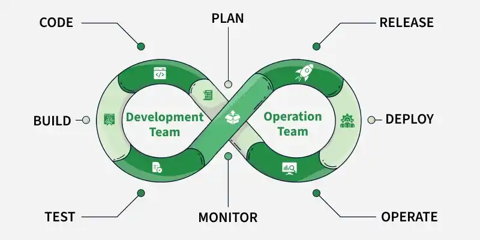

# T2_Theorie_DevOps_Prozesse.md

## 1. Was ist SDLC (Software Development Life Cycle), und wie gliedert sich dieser Prozess?
Der SDLC ist ein Prozess, mit dem Teams Software planen und bauen. Er soll die Projektrisiken klein halten. Die Phasen sind: Planung, Design, Implementierung, Test, Deployment und Wartung.
SDLC wird normalerweise agil verwendet und in die gewissen Phasen aufgeteilt, kann aber auch als Wasserfall verwendet werden.
Mit Quality Gates, Meilensteine, sowie Backlog und Messung von Liefergeschwindigkeiten kontrolliert man und anhand davon wird der Ablauf gesteuert.

## 2. Was ist der DevOps Lifecycle, und wie ist er strukturiert?
Der DevOps Lifecycle ist ein Kreislauf, der Entwicklung und Betrieb verbindet. Er läuft immer wieder durch, mit viel Automatisierung und Feedback. Die Erkenntnisse aus dem Monitoring gehen in die nächste Planung.

## 3. Welche Unterschiede gibt es zwischen dem SDLC und dem DevOps Lifecycle?
- Der SDLC läuft in Phasen ab. DevOps setzt auf Continuous Delivery mit einer automatisierten Pipeline.
- Beim SDLC arbeiten spezialisierte Teams und die Arbeit wird weitergereicht.(Swimlanes) Bei DevOps arbeiten funktionsübergreifende Teams ohne Übergaben.
- Der SDLC führt oft zu grossen releases, da sich vieles ansammelt. DevOps will kleine releases und muss dadurch viel öfters releasen.

## 4. Was ist ein MVP (Minimum Viable Product), und welche Bedeutung hat es im DevOps Lifecycle?
Ein MVP ist ein Produkt mit nur den Funktionen, die das Kernproblem lösen und frühe Nutzer zufriedenstellen. Es muss funktionieren und Nutzen bieten. Es ist ein auslieferbares Produkt und nicht nur eine Idee. Ein MVP ist ein funktionierendes Produkt für frühe Nutzer.

Vorteile eines MVP sind ein schneller Start, frühes Feedback, tiefere Kosten und weniger Risiko, weil man früh prüft, ob Nachfrage besteht. Das Feedback und die Nutzungsdaten fliessen in die nächsten Releases ein.

Im DevOps Lifecycle wird das MVP als erster Durchlauf durch den Kreislauf gebaut. In der Plan-Phase legt man fest, welche Kernfunktionen ins MVP kommen. Danach wird es in Code, Build und Test automatisiert entwickelt und geprüft. Mit Release und Deploy geht es schnell und in kleinen Schritten live. In Operate und Monitor beobachtet man die Nutzung und sammelt Feedback. Diese Erkenntnisse fliessen zurück in die Plan-Phase, und das MVP wird im nächsten Durchlauf verbessert.

## Benutzte Quellen
- https://aws.amazon.com/what-is/sdlc/
- https://www.geeksforgeeks.org/devops/devops-lifecycle/
- https://octopus.com/blog/devops-versus-sdlc
- https://www.objectbay.com/blog/was-ist-mvp
- https://www.geeksforgeeks.org/product-management/minimum-viable-product-mvp/
- https://www.geeksforgeeks.org/software-engineering/